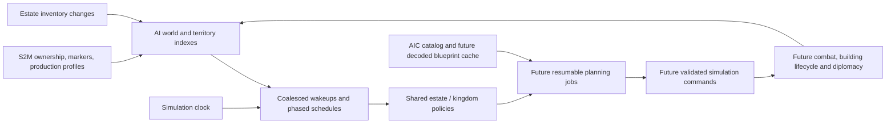

# AI management foundation

## Decision

Use one shared, simulation-thread scheduler with lightweight state per territory.
Each estate and kingdom has its own identity, owner, profile, facts, incidents,
and eventual resumable plans. Shared policy implementations evaluate those records.
These are logical agents, not separate threads, Unity GameObjects, coroutines,
LLM agents, or one behaviour tree per NPC.

An estate manages local production and housing. An AI kingdom manages strategic
construction, defense and military objectives, and coordinates its owned estates.
A human kingdom supplies state/events but receives no autonomous planning calls.
Human-owned *estates* still have autonomous local management, as requested.
An unowned village can be managed locally. A kingdom with unresolved control is
not assumed to be AI-controlled. Allies remain separate owners: an alliance is
not permission to spend another kingdom's resources or command its troops.

## Current implementation

- `Assets/Code/Simulation/AI/AiWorld.cs`: territory/faction identities, indexed
  building facts and counts, read-only planner views, ownership/parent changes,
  attack incidents, parent-kingdom notifications, expiry and change notifications.
- `Assets/Code/Simulation/AI/AiScheduler.cs`: phased periodic work, coalesced
  urgent work, cooperative work budgets, diagnostics and planner fault isolation.
- `Assets/Code/Stronghold2/MapLoading/S2MAiRuntime.cs`: seeds map facts, reads
  production/construction profiles, subscribes to inventory changes, catalogs
  castle files, and cleans up subscriptions on disposal.
- Main creates this runtime after map/population initialization and advances it
  using `SimulationClock.DeltaTime`. Game exposes the active runtime. Main's AI
  settings control scheduling budgets. No additional Unity update components exist.

**The first installed action policy is estate granary construction** (see below).
Recruitment, patrol, combat and blueprint-placement planners remain future work.
Existing startup map adaptation and labor continue independently. Building/attack APIs are
integration points for future authoritative simulation systems, not claims that
combat or destruction detection already exists.

## Data flow

## Clock and scheduling

| Setting | Default | Purpose |
| --- | --- | --- |
| Economy interval | 1 simulation second | Housing, food, staffing and production review |
| Strategy interval | 5 simulation seconds | Castle development, army goals and aid priorities |
| Reaction delay | 0.25 simulation seconds | Coalesce incidents instead of planning for every hit/item |
| Evaluations per Advance | 8 | Cap the number of territory policy calls per frame |
| Logical work per evaluation | 128 units | Cooperative budget for resumable planners |
| Incident cleanups per Advance | 32 | Bound expiry processing, including human territory incidents |

Each territory gets a deterministic starting phase. Sorted due queues avoid
scanning every territory every frame. A territory has at most one routine and
one urgent queue entry; thousands of resource changes merge into one dirty mask.
At most half the dispatch budget is urgent while routine work is due, so attacks
cannot indefinitely starve ordinary management. An urgent-only backlog may use
the full budget when no routine work is due.

Pause/zero game speed produces no decisions or time advancement. Speed is applied
once by the existing clock. Long frames or time jumps coalesce missed reviews:
the next deadline is relative to current simulation time, not a loop replaying
every missed tick. AI disable stops evaluations but still advances incident time.

The work limit is cooperative: planners must call `Budget.TrySpend` for bounded
units of work, retain their cursor and yield on exhaustion. Arbitrary C# code
cannot be forcibly preempted. Never hide an unbounded A*, placement scan or disk
read inside one work unit. The budget object is valid only during its callback.

Scheduling is deterministic for the same ordered events and Advance calls. It
is not yet a lockstep/replay guarantee across different frame partitions; that
requires a fixed simulation tick and persisted scheduler/job state later.

## Facts, ownership and event boundaries

`AiWorld.UpsertBuilding` indexes an existing, newly completed or transferred
building; `RemoveBuilding` removes it idempotently after authoritative destruction.
Per-territory building counts are O(1). Map bootstrap includes both authored and
startup-generated buildings, so later planners must consult counts rather than
assume that a granary or stockpile is absent. Destroying a renderer or swapping
a worker model must never be treated as destruction of the simulation entity.

Inventory updates already reach the world through `EstateInventory.Changed`.
Policies query cached estate totals through `IAiEconomyView`; they don't copy or
sum all stockpile pallets. Local producer buffers remain separate from estate
stores and will need their own bounded query/event adapters. Staffing is still
owned by `LaborManager`; AI must not assign individual workers in competition
with the existing staffing system. Future staffing events can dirty local policy.

Future combat/visibility authorities call `ReportAttack(territoryId, sourceId,
expiresAt)` with an incident/squad ID, not one event or persistent record per
damage point. Refreshing the same incident replaces it. `ClearAttack` clears it;
otherwise it expires. A parent kingdom receives the estate incident as an aid
request, without being incorrectly marked personally under attack. Expired
records may await bounded housekeeping, but `IsUnderAttack` filters timestamps
immediately. Consumers enumerating Threats must likewise check ExpiresAt > Now.

The bootstrap links an estate to an owned kingdom only when exactly one is known.
Multiple possible kingdoms require an explicit parent assignment, rather than an
arbitrary ID or distance guess. Captures change authority, invalidate old aid
relationships and cancel the old scheduler entry when control becomes human.
`NotifyDiplomacyChanged` wakes only members of the affected faction. A complete
relation matrix/visibility system is future authoritative game state, not colours.

Saved-player IDs and initial scenario-lord IDs occupy distinct faction namespaces.
Initial scenario lord 1 is treated as human using the existing ownership adapter's
convention; saved games use the decoded local-human flag. Multiplayer/remote-human
authority and unresolved mixed references need explicit future session mapping.

## Resource profiles and AIC boundary

The modern Scenario's field 4 contains counted estate production codes; field 5
contains construction-mode bytes. Bootstrap reads these from raw counted fields
instead of the older convenience reader's fixed 16-element arrays. Unknown codes
remain unknown. In Chapter 8 these include wood, pitch and iron estate profiles.
Keep the raw production code separate from stockpile Goods IDs: a code can name
multiple goods and a housing tier. A future profile catalog will map verified
codes 0..19 into local production targets. `UseMapBuildings` is a policy constraint
that every future construction planner must respect, not permission to replace
or supplement the authored layout automatically.

The installed `castles/*.aic` files are cataloged once by stable filename and size.
They are not parsed, assigned to lords by filename guesses, or interpreted as
executable commands. `BlueprintKey` can later select a catalog entry. Introduce a
versioned AIC decoder/cache and immutable blueprint representation before placement:
relative sites, orientation/anchor, dependencies, stages and completed/missing slots.
Runtime matching uses actual building IDs; destroyed slots become repair goals.
No mesh, prefab or prerendered map is required.

## Incremental implementation plan

1. Add typed estate profiles and read-only staffing/local-buffer queries. Estate
   policies produce desired counts for granaries, hovels and resource industries,
   honoring construction mode and already existing buildings.
2. Add a central intent/command boundary shared with player orders. Revalidate
   control revision, resources, building availability and placement when committing.
   Reserve costs/sites/jobs atomically so two goals cannot spend the same goods.
   Use idempotent intent IDs and cancel stale intents on capture or destruction.
3. Implement resumable estate construction and AIC matching, with explicit work
   tokens per candidate and asynchronous *simulation jobs*, not per-estate threads.
4. Add combat perception and threat aggregation, then kingdom defense/aid goals.
   Assign squads, targets and patrol routes; ordinary movement/combat systems
   execute them. Use spatial indexes and a shared navigation request budget.
5. Add faction-level aid arbitration, diplomacy and visibility. Avoid multiple
   kingdoms dispatching the same reserve force or claiming the same objective.
6. Add save/replay state: authority revisions, selected blueprint, outstanding
   intents, job cursors, deterministic random state and relative deadlines.
7. Profile before parallelizing. Pure expensive searches can later consume
   versioned immutable snapshots on a shared worker pool; stale results are
   discarded and commands committed serially. Never access Unity objects there.

## Validation and scale

`Notes/tools/AiInfrastructureValidation.cs` checks existing building indexing,
transfer/destruction, attack refresh/clear/expiry, aid/capture cleanup, human control,
pause/speed, coalescing 10,000 notifications, urgent/routine fairness, logical work
budgets, time jumps, planner exceptions, disposal and map-profile/AIC bootstrap.
It also exercises 10,000 territories over 3,000 advances with an eight-evaluation
cap. This validates scheduler overhead, not the cost of future construction or
military planners. No runtime action planner is installed by these tests.

## Estate granary policy

Main installs `S2MEstateGranaryConstruction` after AI initialization and native
granary asset preparation. On economy reviews it considers autonomous estates
only, including human-owned autonomous estates. It requires `Allowed` from the
map's construction setting; `UseMapBuildings` and unknown policy do not create
buildings. A granary already indexed in that estate suppresses the job.

The native granary is free in the reference building data. This stage creates a
completed granary, without a material deduction, builder NPC or construction-stage
animation. It is not a startup building. No kingdom construction policy is added.

Placement prefers estate marker (+2,0), then distance with N/E/S/W ties. The
native 3×3 footprint has a one-cell placement apron on every side. It must remain
inside its estate, avoid other building/apron reservations, walls, water, cutouts,
invalid walking cells, active navigation blockers and excessive slope. The same
troop rule is applied to the granary's 5×5 clearance area: default scan centre
origin (+3,+3), radius seven, horizontal only and independent of allegiance.
Radius, preferred origin, search radius and retry delay are configurable on Main.

Shared placement masks and candidate lists are prepared once and reused. Search
cursors survive callbacks and spend one AI work unit per candidate. A failed
search retries after five simulation seconds instead of restarting every frame.
At most one queued intent exists per estate, and Main processes at most one
intent per advancing frame after the AI callbacks. Pause/zero speed stops commits.

Commit revalidates controller, owner, map policy, granary presence and geometry.
Assets are preloaded before activation; presentation is prepared inactive. The
commit registers a same-estate Granary store, an exact dynamic navigation rectangle,
a zero-worker labor building, the live map placement and the AI building index,
then activates the normal native interior/exterior renderer and colliders.
Failure rolls these registrations back. Placement aprons remain walkable; there
is no extra agent/cart clearance. Runtime placement IDs are distinct from startup
provenance, and the source S2M is never edited.

This consumes current map actor positions. The map's current troops are static;
future authoritative troop movement must call `InvalidatePlacement` when updating
positions in-place (replacing actor/building lists invalidates automatically).
Future destruction must remove the authoritative map/inventory/navigation/labor
records together, then notify AI, rather than deleting only a renderer.

`Notes/tools/EstateGranaryValidation.cs` covers policy/existing-store guards,
kingdom exclusion, incremental work limits, ownership/policy changes while queued,
late external granaries, friendly wall troops, no-site retry, inventory/staffing/
navigation registration and presentation rollback. `EstateGranaryUnityValidation.cs`
checks live construction in Chapter 8 with native assets and captures a preview.

## Estate housing and staffing

The raw Scenario field 4 combines production type with estate population level:
0–7 = Small, 8–14 = Medium, 15–19 = Large. `AiTerritory.PopulationLevel` exposes
the level; `MaximumHovels` is respectively 1, 2 or 3. Unknown codes do not authorize
new housing. Existing authored hovels are preserved even above the header ceiling.

`S2MEstateHovelConstruction` requests one initial hovel, then expands only when
unfilled worker slots exceed idle/unassigned residents plus recruits still due
from already authorized housing. Each hovel supplies eight peasants. Workers
travelling to jobs already occupy their slots; peasants leaving their hovel or
running to the flag remain available supply. Waiting for recruitment never causes
another hovel by itself. Housing goals are reviewed on the bounded AI economy
schedule and revalidated at construction commit. Human-controlled kingdoms are
not given autonomous housing placement.

`Main > Estate Hovel Settings` controls enablement, preferred offset (default
marker +0,+3), search radius, troop exclusion, retry delay and initial estate wood
(default 32). The default is a simulation startup rule, not a decoded original
starting-resource field. It is granted once per estate per inventory, into actual
same-estate stockpiles, so pallet models and queried totals agree. Non-map save
paths do not receive this grant. Hovels always cost six wood; this cost and the
header ceiling are gameplay rules rather than Inspector worker-count settings.

Granary and hovel policies share `S2MEstateBuildingConstruction` for resumable
placement searches and transactional commits. Main processes at most one building
intent per advancing frame across both policies. Placement uses the established
same-estate terrain/building/troop rules and N/E/S/W ties, with a one-cell hovel
apron. A precomputed seating-cell mask protects keep/estate recruitment seats.
New hovels use the native `hovel1.bdg` appearance and normal interior/exterior
rendering, collision, ownership and navigation registration. Authored appearances
continue to come from their native selectors.

Construction reserves six wood across any stockpiles belonging to that estate.
Withdrawals and transfers cannot spend held goods; failed preparation/activation
releases the hold without spending. The cost is deducted only after successful
building registration and activation. Reservations never consume another estate's
inventory. Resources remain ordinary estate resources, not an AI-only balance.

Estate flag recruitment preallocates a bounded dormant pool (at most the header
ceiling times eight, or the authored hovel capacity if higher). No estate peasant
spawns before housing authorizes it. A completed hovel assigns eight slots to its
native doorway and starts their ordinary simulation-time recruitment; they run
to seats around the flag, then enter existing same-estate labor assignment.
Models/animation variants are batched and loaded once, not loaded per birth.
The current finite recruitment lifecycle is retained; ongoing population recovery,
housing demolition/eviction, migration and saved-population restoration remain
separate simulation work.

Staffing queries are available for **both kingdoms and estates**:

- `LaborManager.GetLaborDemand(estateId)` returns `BuildingsNeedingLabor`,
  `RequiredWorkers`, `AssignedWorkers`, `ArrivedWorkers`, `MissingLaborers` and
  `UnknownRequirements`. Counts are cached by territory and updated on reservation,
  arrival, removal and passive-building registration. A three-worker vacancy is
  one building and three laborers. Zero-worker buildings need no staff; undecoded
  worker requirements are reported separately instead of being guessed.
- `LaborManager.GetLaborSupply(estateId)` returns alive, available, pending and
  removed population, scanning only that territory's bounded recruitment pools.
- `Game.AI.World.Territories[id].Labor` mirrors the cached demand through staffing
  events; `DesiredHovels` exposes the latest housing goal.

`EstateHousingValidation.cs` covers all 20 population codes, demand thresholds,
pending births, recruitment/assignment, worker removal, kingdom/estate separation,
exact cost and startup grants, reservations, policy guards and failure rollback.
`EstateHousingUnityValidation.cs` checks native construction and recruitment on
Chapter 8. All six estates in that map decode as Small and build one hovel each,
leaving 26 wood before any production or deliveries.

## First production: estate sawpits

`S2MEstateSawpitConstruction` gives every autonomous estate a sawpit goal, even
when its production profile is food, iron or another non-wood resource. This is
the initial production building goal, not a change to authored map buildings.
`AiTerritory.HasInitialProduction` exposes whether the baseline sawpit exists;
future industry planners should require it before ordering their buildings.

Native numeric building/profile data gives these defaults:

| Header production code | Production profile | Sawpit target |
| --- | --- | --- |
| 3 | Wood | 1 |
| 9 | Wood, iron, stone (Medium) | 2 |
| 12 | Wood, bread (Medium) | 3 |
| 16 | Wood, iron, stone (Large) | 3 |
| All other codes | Other production profiles | 1 |

A sawpit costs **3 wood** and has **one worker slot**. `Main > Estate Sawpit
Settings` controls placement enablement/search settings and an optional target
override for wood-producing estates (zero uses the table). Costs and worker counts
remain fixed gameplay data. Existing sawpits count toward the goal; no excess
building is removed. Kingdom building management is unaffected.

Construction requires housing, a same-estate stockpile and an actual unassigned
resident beyond the labor already owed to existing vacancies. Pending births
never authorize a new production building. Only the next needed production slot
is considered, rather than publishing all future workers at once. If that slot
is affordable but labor is exhausted, `AiWorld.SetPlannedLabor(id,"SawPit",1)`
requests housing capacity. Housing includes `AiTerritory.PlannedLaborers` alongside
current vacancies, while still crediting idle residents and pending recruits.
The prospective request clears on completion, goal satisfaction, loss of funds,
policy disposal or ownership transfer. This lets a busy Medium/Large estate grow
housing without first constructing an unstaffable production building.

The shared builder reserves the cost, places the native `saw_pit.bdg`, installs
its logical navigation obstacle, prepares the woodcutter and GPU equipment,
registers a one-worker `LaborBuilding`, publishes the building, activates it and
then spends the wood. Costs, staffing, ownership and placement are checked again
at commit. Failure removes job slots/equipment/navigation/render registrations
and releases the reserved goods. Failed preparation advances to the next placement
candidate after the retry delay instead of repeatedly choosing an inaccessible
site. The job must be reachable from an available resident's recruitment area and
must have a reachable stockpile destination in its own estate.

Placement retains the established same-estate, terrain, wall, water, cutout,
building, troop and seating restrictions and deterministic N/E/S/W distance ties.
Sawpits use their native one-cell apron on the two local negative axes. Every
navigation subcell inside the footprint must be open, so a trunk/obstacle between
tile centres cannot be covered accidentally. This does not add agent/cart
clearance. Granary, housing and production policies rotate their evaluation order
per territory and share one work budget; they also share one commit attempt per
advancing frame. All timing follows the simulation clock.

Runtime jobs use the existing `WoodcutterBuildingDefinition`, harvest resources,
18-second sawing cycle, 16-plank cargo and incremental same-estate delivery path.
Authored horse-cart placeholders are not reused by runtime-created sawpits.
`LaborManager.RegisterBuilding` extends live read-only job/building lists and
updates cached staffing demand immediately; rollback unregisters the empty job.

Woodcutter worker variants and two hidden equipment templates are loaded once,
including on maps that contain no authored sawpit. `S2MActorRenderer.CloneActor`
instances those templates into reusable 64-slot draw chunks, sharing native meshes,
materials and GPU animation poses. A new cart or saw log requires no model reload,
new skeleton or per-actor GameObject. Failed construction returns its draw slots
to the pool. Normal per-frame worker/equipment updates use the same presentation
path as authored production buildings.

`EstateSawpitValidation.cs` runs the earlier AI/housing/granary checks and tests
all 20 profile targets, exact costs, available/pending/assigned labor, vacancy
priority, housing coordination under full employment, map policy and kingdom
exclusion, labor lost before commit and complete job/equipment rollback.
`EstateSawpitUnityValidation.cs` loads Chapter 8, constructs and staffs all six
estate sawpits, then exercises the real harvest/saw/delivery state machine using
nearby test foliage. It checks exact resource totals and 700 GPU equipment clones,
slot reuse and unchanged actor GameObject counts. This is a functional instancing
check, not a GPU frame-rate benchmark. The native Chapter 8 profiles are all Small;
Medium/Large expansion thresholds are covered by the headless cases.

### Sawpit terrain and tree-centred placement

Runtime sawpits now acquire the same physical **1×2-cell terrain opening** observed
for static sawpits. `S2MAiBuildingPresentation` opens it at activation and releases
it on disposal/failed construction. Rotation follows the native model origin;
the one-cell apron and larger authored worker-clearance rectangles are excluded.

`S2MTerrainEdits` maintains a reference-counted overlay over the loader's immutable
saved cutout mask. `S2MTerrainChunk` retains triangle ranges for each cell, including
subdivided cliffs. Editing a hole updates only affected chunks' triangle indices
and recooks their mesh colliders; vertices, source heights, UVs, textures and
materials remain intact. Empty chunks have no collider mesh. Releasing one of two
overlapping openings does not restore occupied cells, and original saved holes
remain suppressed. No whole-map terrain rebuild is performed per placement.

`Main` supplies the live `FoliageResources` index to the sawpit policy. For each
same-estate stockpile it finds the nearest standing tree from the centre of that
stockpile's footprint, then chooses the closest stockpile/tree pair (stable IDs
break equal-distance ties). The preferred building origin puts its physical centre
by that tree. Existing nearest-site search, N/E/S/W ties, estate boundaries,
clearance, troop, terrain, navigation and seating rules then find a legal site.
Search radius and preferred offsets now apply around this tree-centred origin,
not the estate marker. Trees may lie beyond the estate border; buildings still
must fit inside their own estate. Bushes are considered only if no standing tree
exists. A missing foliage provider does not fall back to marker placement.

`FoliageResources.NearestTreeSearch` visits expanding spatial bucket rings, stopping
once unvisited space cannot contain a closer tree. Each bucket/resource step spends
the same cooperative work budget as placement candidates. Queries do not reserve
or mutate foliage. They are cached across callbacks and re-evaluated when the
selected tree is felled/removed or the estate's stockpile set changes; a stale tree
also cancels an already queued site before construction. No-resource retries use
the existing simulation-time retry interval. `ResourceSearchSteps` exposes this
work separately from placement candidate tests.

`SawpitSitingValidation.cs` checks the spatial query against exhaustive results,
shared work limits, multiple stockpiles/foreign-store filtering, no reservation
side effects, stale-tree cancellation and rotated physical masks.
`SawpitTerrainUnityValidation.cs` checks actual mesh/collider holes, chunk-boundary
updates, overlapping leases, rotation/axis flips, presentation rollback, and six
Chapter 8 tree-centred sawpits through the complete production/delivery loop.
